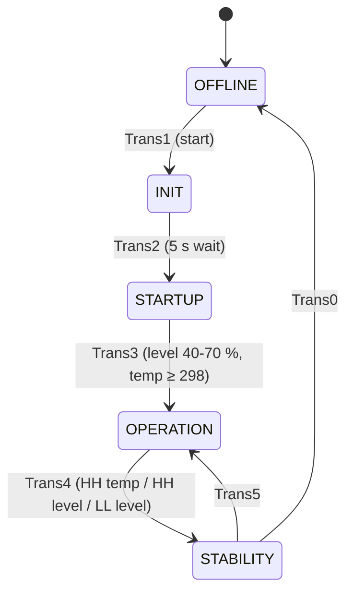

# 10 – Tank Process Controller (SFC + LD, FBD, ST, CFC, IL)

**Platform:** ABB CODESYS (Automation Builder) · IEC 61131-3 · *simulated*

## Overview
A heated, mixed tank with an inlet pump, an outlet valve, a heater and a mixer. The machine is a **Sequential Function Chart (SFC)** whose five steps are each written in a **different IEC 61131-3 language**, to show fluency in all of them. A built-in simulation moves level and temperature, so the whole process runs without hardware.

## Architecture

*(Check the last two transitions against your SFC chart and adjust the labels if needed.)*

| Mode | Step | Language | Role |
|---|---|---|---|
| 0 | OFFLINE | **LD** | Sets `Mode` = 0; start button → rising-edge one-shot → `systemTrigger`; seals in `systemRunning` (broken by the interrupt contact); drives `Trans1` |
| 1 | INIT | **FBD** | Sets `Mode` = 1; zeroes `LvlInput`, `TempInput`, `LvlRes`, `TempRes`; a 5 s `TON` (`takeTime`) fires `Trans2` |
| 2 | STARTUP | **ST** | Loads the rate constants, fills the tank, heats it, runs the mixer, then checks the start-up window before `Trans3` |
| 3 | OPERATION | **CFC** | Continuous control of level and temperature, alarm detection, run-time meter |
| 4 | STABILITY | **IL** | Corrective actions for the active alarm, then a 10 s hold before leaving |

An extra ST program (`counter`) uses a `CTU` on `secondStageActive` to produce `secondStageCount`, the number of times the machine has gone through start-up.

## Global variables
| Variable | Type | Purpose |
|---|---|---|
| `systemRunning` | BOOL | Machine running (seal-in) |
| `LvlInput`, `TempInput` | DINT | Raw analog inputs |
| `LvlRes`, `TempRes` | REAL | Simulated level (%) and temperature |
| `Pump`, `Mixer`, `Valve`, `Heater` | BOOL | Outputs |
| `FillRate`, `DrainRate`, `HeatUp`, `DropHeat` | DINT | Rates of change used by the simulation |
| `HHTempAlm`, `LLLvlAlm`, `HHLvlAlm` | BOOL | Alarm flags |
| `secOP`, `minOP`, `hourOP` | TIME / DINT / DINT | Operation run-time meter |
| `Mode` | DINT | Current stage number (0–4) |

## How each stage works

### 0 · OFFLINE (LD)
`Mode` ← 0. A rising edge on `systemStart` (`R_TRIG`) sets `systemTrigger`. `systemRunning` seals in through its own contact and drops when the interrupt contact opens. The same rung drives `Trans1`.

### 1 · INIT (FBD)
`secondStageActive` = `systemRunning` AND TRUE. `Mode` ← 1. Four `MOVE` blocks reset the inputs and simulated values. A 5 s on-delay timer (`takeTime`) outputs `doneWait`, which drives `Trans2`.

### 2 · STARTUP (ST)
Sets the simulation rates (`FillRate` 2, `DrainRate` 1, `HeatUp` 2, `DropHeat` 1) and `Mode` ← 2. While the system runs:
1. **Fill** until the level reaches the start-up band, with a 500 ms simulation tick and a 5 s delay on the pump.
2. **Heat** toward 350° with a 5 s delay on the heater, stopping above 300°.
3. **Mix:** the mixer runs while temperature stays above 300°, with a 30 s timer on the stop path.
4. When level is between 40 % and 70 % and temperature is above 298°, `Trans3` is set.

### 3 · OPERATION (CFC)
- `Valve` = `systemRunning`; `Mode` ← 3; the level falls by `DrainRate` while the valve is open.
- **Level control with hysteresis:** pump starts (after a 5 s delay) when level ≤ 20 and stops (after 1 s) when level ≥ 65. Each 500 ms tick while the pump runs adds `FillRate` to level and subtracts `DropHeat` from temperature.
- **Temperature control with hysteresis:** heater starts (5 s delay) when temperature ≤ 400 and stops at ≥ 460; each 500 ms tick while heating adds `HeatUp`.
- **Alarms:** temperature > 500 → `HHTempAlm`; level < 20 → `LLLvlAlm`; level > 80 → `HHLvlAlm`. Each alarm drives `Trans4` to the Stability step. The flags clear on their own when the condition clears.
- **Run-time meter:** a self-restarting `TON` (`operationTime`) feeds a seconds→minutes→hours chain (`MinCounter`, `HoursCounter`) and the results are copied to `secOP`, `minOP`, `hourOP`.

### 4 · STABILITY (IL)
`Mode` ← 4, then the program checks which alarm is active and jumps to its corrective block:
| Alarm | Corrective action |
|---|---|
| HH level (> 80 %) | Open valve, pump off, drain level |
| LL level (< 20 %) | Close valve, pump on, fill level |
| HH temperature (> 500°) | Heater off, pump / mixer / valve on, cool temperature faster than normal |
After a 10 s hold with all outputs off, a decision variable chooses the exit (`Trans0` or `Trans5`).

## Concepts demonstrated
SFC step/transition design · all five IEC 61131-3 languages in one project · hysteresis control · on-delay timers on every output · simulation of a process in software · alarm-triggered recovery mode · cascaded counters.

## Review notes (worth fixing, and good to talk about in interviews)
- **Timers inside `WHILE` loops (STARTUP):** a PLC executes the whole loop within one scan, so timers called inside a loop do not advance between iterations. A more robust ST version uses a state variable (a `CASE` statement) and lets the scan cycle provide the time.
- **Copy-paste in STARTUP:** the heater and mixer paths read `ons2.Q` / `Time1.Q`, which belong to the pump logic. They should use their own one-shots.
- **Simulation tick in OPERATION:** the fill and heat updates are gated by 500 ms timers, but the drain subtraction appears to run every scan. Gate it with its own 500 ms trigger so level changes match the spec.
- **Run-time meter presets:** the seconds timer is 59 s and the minutes counter 59. Use 60 s / 60 for exact minutes and hours.
- **Spec alignment:** the brief asks for 10 s alarm trigger/reset delays and a meter that totals time spent in mode 4 (updated on exit); the current program measures operation time and the alarm conditions are immediate comparisons.

## Add to this folder
- SFC chart screenshot (steps and transitions)
- One screenshot per stage program (LD, FBD, ST, CFC, IL)
- A trace or watch-window screenshot showing level and temperature through a full run, and one alarm → Stability → return
